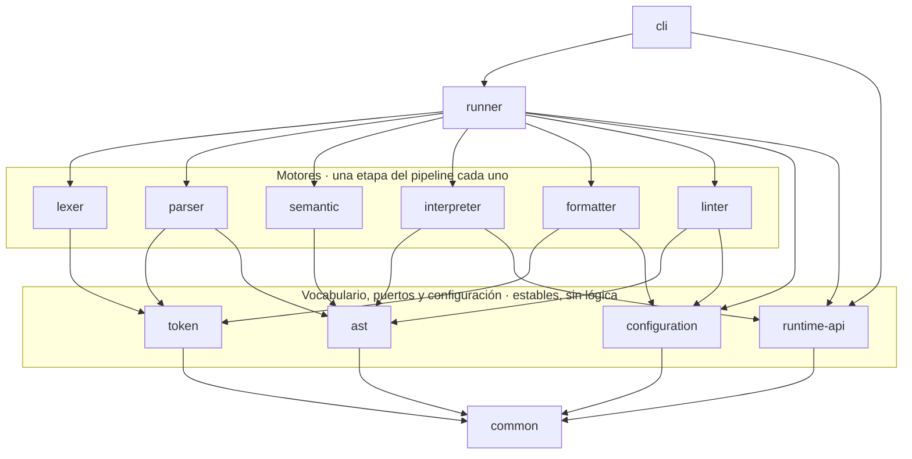
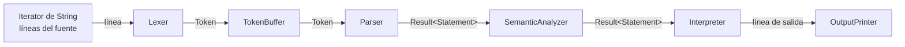

# Arquitectura de PrintScript

Diagrama de componentes, responsabilidad de cada módulo y cómo interactúan entre ellos.

El criterio de descomposición es el de Parnas: cada módulo esconde **una decisión de diseño**, y dos módulos quedan separados si y solo si cambian en momentos distintos y por razones distintas. Las flechas se leen "depende de" y van siempre hacia abajo: el grafo es acíclico.

---

## 1. Estado actual

Trece módulos Gradle, cada uno con su propio set de dependencias, compilando por separado.



> Las aristas hacia `common` desde los seis motores, `runner` y `cli` se omiten por legibilidad: **todos dependen de `common`**.

Cinco cosas para leer en ese grafo:

- **Los seis motores no se conocen entre sí.** No hay ninguna flecha horizontal. Consumen vocabulario, nunca el módulo de al lado. El `linter` no conoce al `parser`: recibe el flujo de sentencias ya armado. El `formatter` va un paso más atrás y consume tokens, no el árbol.
- **`semantic` está entre el parser y el interpreter**, y es lo que hace que el modo Validation de la consigna valide de verdad la semántica y no solo la sintaxis. Depende de `ast` y no de `parser`: consume el vocabulario, no la gramática.
- **`runtime-api` es un módulo de puertos**: `OutputPrinter`, `InputProvider` y `EnvProvider`, más el `RuntimePorts` que los junta. No depende de nada: es el único módulo sin una sola dependencia, y eso es lo que permite que `cli` e `interpreter` lo implementen y lo consuman sin conocerse.
- **Nadie depende de `interpreter`, `linter` ni `formatter`.** Son hojas: lo que más cambia está arriba de todo, donde romperlo no rompe a nadie.
- **`cli` es el único que toca filesystem, `System.out`/`System.err`, `System.getenv` y códigos de salida**, y el único punto de entrada ejecutable (`org.printscript.cli.Cli.main`). No depende de `lexer`, `parser`, `interpreter`, `ast` ni `token`: solo de `runner`, `runtime-api` y `common`.

---

## 2. Responsabilidad de cada módulo

| Módulo | Decisión que esconde | Cambia cuando… | Depende de | Estado |
|---|---|---|---|---|
| `common` | Cómo viaja un dato o un error por el pipeline y cómo se ubica algo en el fuente | Casi nunca: cambiaría la forma del pipeline | — | ✅ |
| `token` | Qué es un token y qué categorías existen | Casi nunca: cambia la noción de token, no el lenguaje | `common` | ✅ |
| `ast` | La forma del árbol y el contrato de recorrido | El lenguaje gana construcciones | `common` | ✅ |
| `runtime-api` | Cómo habla un programa en ejecución con el mundo exterior | Cambian los canales de E/S del programa | — | ✅ |
| `lexer` | Cómo se reconoce un token dentro del texto | Cambian las reglas léxicas | `common`, `token` | ✅ |
| `parser` | La gramática y cómo se construye el árbol | Cambian las reglas sintácticas | `common`, `token`, `ast` | ✅ |
| `interpreter` | Qué efecto produce cada nodo al ejecutarse | Cambia la semántica de ejecución | `common`, `ast`, `runtime-api` | ✅ |
| `configuration` | En qué formato vive la configuración (JSON, YAML, mañana TOML) | Aparecen formatos nuevos | `common` | ✅ |
| `semantic` | Qué programas bien formados tienen sentido | Cambian las reglas de tipos y scope | `common`, `ast` | ✅ |
| `formatter` | Cómo se ve el código | Cambian las reglas de estilo | `common`, `token`, `configuration` | ✅ |
| `linter` | Qué convenciones se exigen | Cambian las convenciones | `common`, `ast`, `configuration` | ✅ |
| `runner` | Cómo se arma el pipeline de cada operación | Aparecen operaciones nuevas | todos los anteriores | ✅ |
| `cli` | La experiencia de línea de comandos | Cambian argumentos, progreso, exit codes | `runner`, `runtime-api`, `common` | ✅ |

---

## 3. Cómo interactúan: el pipeline en streaming

La consigna exige que un fuente que no entra en memoria se pueda procesar igual, y que no se haga todo el análisis léxico antes de pasar a la etapa siguiente. De ahí sale el mecanismo central: **ninguna etapa produce una colección, todas producen un flujo**.

El contrato compartido es el `Iterator<T>` estándar de Java, con `hasNext()` y `next()`. Lo implementan las cinco etapas; lo único que cambia entre ellas es la `T`. No hay una interfaz propia: el contrato de iteración es el de la plataforma. `semantic` no transforma el dato: recibe `Result<Statement>` y devuelve `Result<Statement>`, así que se encadena sin que el parser ni el intérprete sepan que existe.



### Dos flujos en direcciones opuestas

Esta es la parte que conviene tener clara: **los datos van hacia adelante, los pedidos van hacia atrás**.

```
DATOS      archivo ──► lexer ──► parser ──► semantic ──► interpreter ──► salida
CONTROL    archivo ◄── lexer ◄── parser ◄── semantic ◄── interpreter ◄── while (hasNext)
```

Todo el pipeline es *pull*. Nadie empuja. Cuando el consumidor pide un resultado, ese pedido se propaga hacia atrás hasta el lexer, y si hace falta se lee una línea nueva del archivo. El dato vuelve hacia adelante transformándose en cada etapa.

El texto entra al sistema **en un solo lugar**: el constructor del `Lexer`, que recibe un `Iterator<String>`. Ninguna otra clase tiene una referencia a la fuente.

### Qué está vivo en memoria

En cualquier instante de la ejecución:

- una línea de texto (`Lexer.currentLine`),
- los tokens de la sentencia que se está armando (`TokenBuffer.retained`),
- el árbol de esa sentencia,
- el `Environment` acumulado.

Nunca el programa entero. El único acumulador es el `TokenBuffer`, y su cota es la sentencia más larga.

### Los errores viajan como dato

Ninguna etapa comunica errores de dominio por excepción. El canal es `Result<T>`, que es o `Success<T>(valor)` o `Failure<T>(mensaje, Range)`, y viaja por el mismo camino que los resultados válidos. Todo error lleva el `Range` completo — fila y columna de inicio y de fin — como exige la consigna.

Un error no detiene la iteración: la sentencia siguiente se procesa igual. Decidir si frenar al primer error o acumularlos es una política, y le corresponde al `runner`.

---

## 4. Las aristas que no están, y por qué

Tan importante como las dependencias que existen son las que se evitaron deliberadamente.

**`parser` no depende de `lexer`.** Es la ausencia más importante del diseño. El `TokenBuffer` recibe un `Iterator<Token>` cualquiera, así que el parser se escribe, compila y testea sin que exista el lexer — de hecho todos sus tests lo alimentan con listas de tokens armadas a mano. El parser depende de una abstracción estable (el vocabulario `token` más el contrato de iteración), no de una implementación volátil.

**`interpreter` no depende de `parser` ni de `lexer`.** Consume `Iterator<Result<Statement>>`. De dónde salgan esas sentencias no es asunto suyo.

**`interpreter` no depende de `token`.** Una vez armado el árbol, los tokens dejaron de existir. Si los conociera, un cambio léxico lo recompilaría sin razón.

**`lexer` no depende de `ast`.** El lexer no sabe qué es una expresión: solo parte texto en piezas.

**`linter` no depende de `semantic`.** Es lo que permite lintear código con errores de tipos.

**`formatter` no depende de `ast` ni de `parser`.** Consume tokens. Formatear es decidir el espacio entre dos tokens, y el árbol no guarda esa información: el whitespace se descarta en el lexer. La posición sí sobrevive, así que el espacio original se reconstruye con la distancia entre el fin de un token y el inicio del siguiente, sin guardarse el archivo. La consecuencia visible es que se puede formatear un programa que no parsea, que es justo cuando más falta hace.

**`cli` no depende de `interpreter`.** Los puertos que el `cli` implementa viven en `runtime-api`, no dentro del intérprete. Si vivieran ahí, el `cli` tendría que depender del intérprete entero para escribir dos clases de tres líneas, y cualquier cambio interno del `Executor` lo recompilaría.

**Nadie depende de `interpreter`, `formatter` ni `linter`.** Son hojas del grafo, y son justamente los módulos que más cambian.

---

## 5. Cómo entra una versión nueva del lenguaje

Cada módulo con conocimiento del lenguaje expone una **factory**, y esa factory es su provider por versión: `LexerFactory`, `ParserFactory`, `SemanticFactory` e `InterpreterFactory`. **Los motores no saben nada de PrintScript ni de que las versiones existen**: reciben ya armadas las piezas que definen el lenguaje.

```java
// El motor no tiene ni una palabra de PrintScript escrita adentro
public Lexer(Iterator<String> lines, List<TokenConstructor> constructors)

// La factory es la única que sabe qué palabras tiene cada versión
case V11 -> Map.of(
        "const", TokenType.KEYWORD,
        "if", TokenType.KEYWORD,
        "true", TokenType.BOOLEAN);
```

`Version` vive en `common` porque la nombran varios módulos y no cambia nunca. El **contenido** de cada versión no vive ahí: vive en la factory de cada módulo.

| Factory | Qué cambia entre versiones |
|---|---|
| `LexerFactory` | las keywords y los símbolos |
| `ParserFactory` | qué sentencias existen, qué declaradores hay, qué funciones de lectura, y qué `StatementDelimiter` se usa |
| `SemanticFactory` | qué tipos existen |
| `InterpreterFactory` | qué construcciones se pueden ejecutar |

Un `grep` de `case V11` fuera de esas cuatro clases no devuelve nada, y esa es la propiedad que hay que conservar: **si aparece un `if (version == ...)` adentro de un motor, está en el lugar equivocado.**

Las fachadas del `runner` toman la versión como parámetro y mantienen además la firma sin versión, que delega en 1.0: la consigna define la versión como argumento opcional con ese valor por defecto.

**Riesgo conocido:** las cuatro factories reparten el conocimiento de una versión entre varios módulos, lo que permite inconsistencias — un lexer que reconoce `if` con un parser que no sabe qué hacer con él. Se mitiga por dos vías: la compuerta de nodos del `Interpreter`, que ante un nodo que no pertenece a la versión devuelve un `Failure` explícito en vez de romper, y los tests end-to-end por versión del `runner`, que ejercitan el pipeline completo contra los ejemplos de la consigna y contra un programa que usa las cinco construcciones de 1.1.

---

## 6. Trade-offs asumidos

**Streaming contra atomicidad de la ejecución.** En una sola pasada, cuando aparece un error en la sentencia 40, las 39 anteriores ya se ejecutaron y su salida ya salió. Garantizar "no ejecutar nada si hay algún error" exigiría materializar el programa entero, que es lo que la consigna prohíbe. La mitigación es la operación `validate` como pre-chequeo completo: quien necesite atomicidad corre validate y después execute.

**La cota de memoria de los bloques.** Una sentencia se corta cuando aparece un `;` en profundidad 0 o cuando una `}` devuelve la profundidad de 1 a 0, así que los tokens de un `if` entero se acumulan antes de parsearlo: **la memoria queda acotada al bloque más grande, no al programa**. No es una regresión frente a la alternativa —un descenso recursivo tiene la misma cota, porque el nodo `IfStatement` necesita su cuerpo como lista de todos modos— y sigue cumpliendo lo que pide la consigna, que es no materializar el fuente completo. Hay un test que lo fija.

**`Block` es un nodo y no una `List<Statement>`.** Cuesta un nodo más en el AST, y por lo tanto un `visit` más en cada visitor. Se paga por dos cosas. La primera es que `else if (b) {}` y `else { if (b) {} }` colapsarían al mismo árbol sin él, y el formatter tiene que imprimir uno en la misma línea y el otro anidado. La segunda es que el scope pasa a ser exactamente un `Block`, así que `semantic` y el intérprete abren y cierran frame en un solo lugar, sin casos especiales para el `then` y para el `else`.

**El formatter reescribe, no imprime.** La consigna define un conjunto de reglas que actúan cada una sobre un espacio concreto, y exige que lo que ninguna regla nombra quede byte a byte como estaba: su caso testigo conserva `let twice_thing : string` intacto porque la regla del espacio antes del `:` está apagada. Un impresor del AST no puede cumplirlo —ese espacio ya no existe en el árbol—, así que el formatter trabaja sobre el flujo de tokens. Lo que se gana es la fidelidad que el TCK pide y poder formatear código que no parsea; lo que se pierde es el pretty-printing: un `if(true){println(1);}` en una línea sale igual, porque ninguna regla dice dónde van los saltos adentro de las llaves. Tres efectos visibles: no se agrega un salto final que el fuente no tenía, `formatting` ya no reporta errores de sintaxis (sí los símbolos que el lexer no puede leer), y la profundidad para indentar se cuenta con llaves en vez de leerse del nodo `Block`.

**Visitor exhaustivo.** Agregar un nodo al AST rompe en compilación todos los visitors existentes. Se asume como mecanismo de seguridad, no como defecto: el error de compilación funciona como checklist de qué herramienta tiene que decidir qué hacer con la construcción nueva. Es lo que obligó a decidir, por ejemplo, que `println(true)` es un argumento simple y `println(readInput("x"))` no.

**El costo del contrato único, y cómo se acotó.** `ASTVisitor` cubre expresiones y sentencias juntas, así que un visitor de sentencias tiene que rechazar toda expresión y viceversa. Ese rechazo se escribía repetido en cada implementación y crecía con cada nodo nuevo — CPD lo detectó como duplicación real entre `Executor` y `StatementChecker`. Ahora vive una sola vez, en `StatementOnlyVisitor` y `ExpressionOnlyVisitor`: un nodo de expresión nuevo se agrega en un solo lugar en lugar de en cuatro.

**Dónde vive la conversión de lo que entra de afuera.** `readInput` y `readEnv` valen `string`, y el tipo declarado manda la conversión. Ocurre en el sitio de la declaración y de la asignación, no adentro de la lectura, y se aplica siempre: para cualquier otro inicializador es un no-op porque `semantic` ya garantizó que el tipo coincide. Así el `Executor` no tiene que preguntar de qué nodo vino el valor. La excepción semántica que lo habilita es acotada a propósito —vale solo cuando el inicializador es *exactamente* una lectura— porque propagarla adentro de las expresiones la volvería incheckeable.

**Trece módulos.** El número no es el criterio; la independencia de razones de cambio sí. `configuration`, `semantic` y `runtime-api` existen porque cada uno esconde una decisión distinta con evolución propia. La única fusión que no rompería razones de cambio sería `runner` dentro de `cli`, y se descarta porque PrintScript se publica como librería.

---

## 7. El módulo `runner`

Es el único lugar del sistema donde el lexer y el parser se conocen entre sí. `ExecutionRunner` recibe el iterador de líneas y un `OutputPrinter`, le pide a las tres factories las piezas del pipeline, encadena `Lexer` → `TokenBuffer` → `Parser` → `Interpreter` y corre el bucle `while (hasNext) next`. El armado de la cadena lexer→buffer→parser vive en `StatementStreams`, una clase package-private con una única función estática que comparten las dos fachadas: la construcción existe en un solo lugar.

`ValidationRunner` es la segunda fachada: arma la misma cadena pero se detiene antes del interpreter, sin `OutputPrinter` — la firma de `validate` ni siquiera recibe uno. Recorre el flujo de sentencias, junta los `Failure` con su mensaje y su `Range`, y no ejecuta nada: validar un programa con `println` no imprime.

`StatementStreams` ofrece **dos cadenas**, y cuál usa cada fachada es una decisión de diseño y no un olvido:

- `validatedStatementStream` — lexer → buffer → parser → **semantic**. La usan `validate` y `execute`. Es lo que hace que el modo Validation valide semántica, y lo que le garantiza al `Executor` su precondición de recibir sentencias ya validadas.
- `statementStream` — sin `semantic`. La usan `format` y `lint`, porque **se tiene que poder formatear y lintear un programa con errores de tipos**, que es justo cuando más falta hace. Hay un test end-to-end dedicado a que esa decisión no se pierda.

`AnalyzingRunner` es la tercera fachada: arma `Lexer` → `TokenBuffer` → `Parser` → `Linter` reusando el mismo `StatementStreams`, y devuelve un `AnalysisReport` con dos listas separadas — las violaciones de estilo y los errores de sintaxis. **No pasa por `semantic`**, y no va a pasar cuando exista: se puede lintear un programa que no tipa. Tiene un segundo `analyze` que recibe el stream de configuración y su formato, y es el único lugar donde se cablean los mappers de `configuration`.

El invariante del módulo: **compone, no decide**. No tiene ni una regla del lenguaje; todo el conocimiento del lenguaje sigue en las factories.

**La política con los errores es acumular, no cortar.** Las etapas deliberadamente no la toman, así que la decisión vive acá: la fachada junta los `Failure` que salen del bucle — con su mensaje y su `Range` — y los devuelve como lista al terminar. Un error no detiene la ejecución del resto del programa.

**Trade-off asumido.** Como la ejecución es en una sola pasada, cuando aparece un error las sentencias válidas anteriores ya se ejecutaron y su salida ya salió. Quien necesite atomicidad corre primero la validación.

**Comportamiento anotado: imprimir una variable declarada sin valor.** Hoy el valor guardado para una declaración sin inicializador es `null`, y `asText` lo convierte con `String.valueOf`, así que `println` imprime `null`. No es lo que debería pasar en un lenguaje con chequeo de tipos, y `semantic` tampoco lo detecta: hoy acepta una declaración sin inicializador y no marca el uso posterior de esa variable. Queda anotado como pendiente de una regla de "usada antes de asignarse".

---

## 8. El módulo `cli`

Es el único punto de entrada ejecutable del sistema (`org.printscript.cli.Cli.main`) y el único módulo autorizado a tocar filesystem, `System.out`/`System.err` y códigos de salida — el resto son librerías puras. Traduce argumentos con **picocli** a un `RootCommand` con cuatro subcomandos, uno por operación de la consigna: `execution`, `validation`, `formatting` y `analyzing` (con sus alias). A partir de ahí nada depende de picocli salvo las clases de comando mismas.

`ExecutionCommand` y `ValidationCommand` comparten `AbstractSourceFileCommand`, y `AnalyzingCommand` sigue el mismo patrón: todos abren el archivo fuente vía `SourceFileProcessor`, que arma un `Iterator<String>` de líneas con progreso y delega en la operación concreta (`ExecutionRunner`/`ValidationRunner`/`AnalyzingRunner`). Cero lógica de lenguaje en `cli`: solo abre archivos, arma el iterador y reporta lo que el `runner` devuelve.

**Interfaz interactiva.** Correr `cli` sin argumentos abre `InteractiveShell`, un REPL que mantiene su propio directorio de trabajo para navegar el filesystem (`pwd`/`ls`/`cd`) y correr las operaciones sobre archivos relativos a él. No duplica nada: usa el mismo `SourceFileProcessor` y los mismos runners que los subcomandos, así que el resultado es idéntico al de la forma no interactiva.

**Progreso durante el parseo.** `ProgressReportingIterator` decora el iterador de líneas: estima el porcentaje consumido con `Files.size` (una sola llamada, sin releer el archivo) y bytes acumulados por línea, y solo escribe a `System.err` cuando el porcentaje entero cambia. El lexer y el parser nunca se enteran de que existe.

**Errores con rango completo.** `FailureReporter` formatea cada `Failure` (mensaje + `Range` con fila/columna de inicio y fin) a `System.err`, tal como exige la consigna.

**`--version` se traduce en el borde.** `LanguageVersion` es un converter de picocli que acepta `1.0` y `1.1` y rechaza cualquier otra cosa nombrando las válidas. Se queda en `cli` porque es la forma del **argumento**; lo que viaja hacia adentro es el `Version` del dominio, así que ningún módulo de abajo sabe cómo se escribió. Los cuatro subcomandos la toman del comando raíz y se la pasan a las fachadas del `runner`. La interfaz interactiva tiene su propio comando `version`, que fija la versión de la sesión.

**Los puertos de entrada.** `SystemEnvProvider` es el único lugar del sistema que llama a `System.getenv`. `ConsoleInputProvider` **recibe** el `BufferedReader` en vez de abrir uno propio: la shell interactiva ya tiene su lector sobre `System.in` para los comandos, y dos lectores sobre el mismo stream se comen las líneas del otro de forma intermitente. Por eso el `readInput` lanzado desde el REPL lee del mismo lector que la shell.

**`analyzing` corre el linter y `formatting` corre el formatter.** Ambas cargan las reglas del `--config` (JSON/YAML) vía el módulo `configuration` con el helper compartido `ConfigurationFiles`, y sin `--config` no hay ninguna regla activa: el linter no reporta nada y el formatter devuelve el archivo intacto. `AnalyzingCommand`/`LintAnalysis` corren el `AnalyzingRunner` y reportan las violaciones (prefijo `lint:` + rango) y los errores de sintaxis; `FormattingCommand`/`Formatting` corren el `FormattingRunner` y escriben el código formateado por stdout o, con `--output`, a un archivo (nunca pisan el fuente). Las cuatro operaciones tienen backend hoy; el `UNSUPPORTED_OPERATION` (exit code `3`) queda reservado para cuando se sume una operación sin implementar.

**Guardar la salida (`execution --output` / `save`).** `ExecutionOutput` teea la salida del programa por un `TeeOutputPrinter` hacia la consola y hacia un `WriterOutputPrinter` sobre un archivo, así el programa se ejecuta una sola vez y su salida queda mostrada y guardada. El REPL expone esto como el comando `save`, que deriva el `.txt` junto al fuente.

**Códigos de salida:** `0` éxito, `1` el programa `.ps` tiene errores de validación/ejecución o el análisis encontró violaciones, `2` error de uso (argumentos inválidos, versión no soportada, archivo o configuración inexistente o mal formada), `3` operación pedida pero no implementada. Guía de uso completa con ejemplos en [`docs/cli.md`](cli.md).

## 9. El módulo `linter`

Es el *static code analyzer* que pide la consigna: analiza los programas PrintScript del usuario. **No tiene nada que ver con Checkstyle, PMD ni Spotless**, que analizan nuestro código Java y viven en `config/` y en `buildSrc/`.

Es una etapa más del pipeline: implementa `Iterator<Result<List<Violation>>>` y decora al parser, así que consume una sentencia por vez y un fuente que no entra en memoria se lintea igual que se ejecuta.

**Las violaciones viajan como dato.** Por cada sentencia, o un `Failure` reenviado del parser, o un `Success` con la lista de lo que incumple — vacía cuando está limpia. Ninguna regla corta a las que siguen y ninguna violación corta a la sentencia siguiente, que es lo que pide la consigna cuando dice que hay que reportar todos los incumplimientos.

**Cada violación lleva el `Range` de aquello de lo que habla**, no el de la sentencia entera: el del identificador mal escrito, el del argumento inválido. Para eso `VariableDeclaration` y `AssignmentStatement` guardan su nombre como `Identifier` y no como `String`.

### El recorrido se escribe una sola vez

`IdentifierCollector` es un `ASTVisitor<List<Identifier>>` y es el único lugar donde se baja por el árbol. Las reglas lo usan; no recorren. Cuando el AST gane un nodo, el visitor deja de compilar y avisa dónde hay que decidir.

`PrintlnArgumentRule` no recorre nada: mira el hijo inmediato del `println` con un switch exhaustivo sobre `Expression`. La regla está escrita en positivo — solo un identificador o un literal — así que un tipo de expresión nuevo también rompe la compilación en vez de colarse.

### Las reglas se configuran al construirse

`LintRule` tiene un solo método, `check(Statement)`. La configuración no viaja en cada llamada y la regla no guarda estado: `LinterFactory` decide qué reglas existen y con qué parámetros, y **una regla apagada simplemente no está en la lista**.

| Clave del archivo | Qué prende | Valores |
|---|---|---|
| `identifier_format` | El formato exigido a los identificadores | `camel case` (también `camelCase` y `camel_case`) |
| `mandatory-variable-or-literal-in-println` | Que `println` reciba solo un identificador o un literal | `true` / `false` |

Una clave ausente deja la regla apagada. Un valor **desconocido** en `identifier_format` rompe con un mensaje que nombra el valor recibido y los soportados, en vez de apagar la regla en silencio.

**Las dos convenciones de identificador están soportadas.** `camel case` y `snake case`, cada una con su `IdentifierFormatChecker` y su valor en el enum `IdentifierFormat`. La segunda entró para cumplir el TCK, que trae casos de las dos, y no cambió nada de lo que ya estaba escrito: es exactamente la extensión que el diseño preveía.

### El linter no sabe qué es JSON

Recibe una `LinterConfiguration` tipada. Leer el archivo es trabajo de `configuration`, y traducir esa configuración genérica a la del linter es trabajo de `LinterConfiguration.from`. Así el módulo no arrastra Jackson y sus tests no necesitan un archivo.
