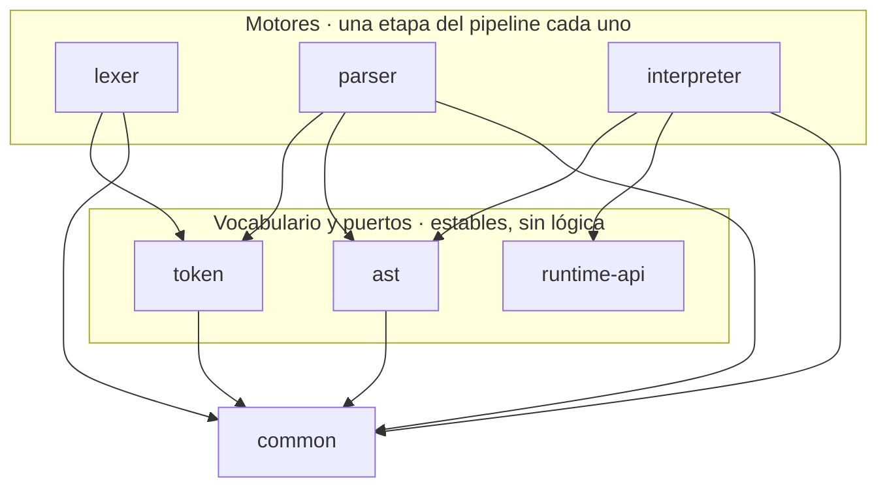
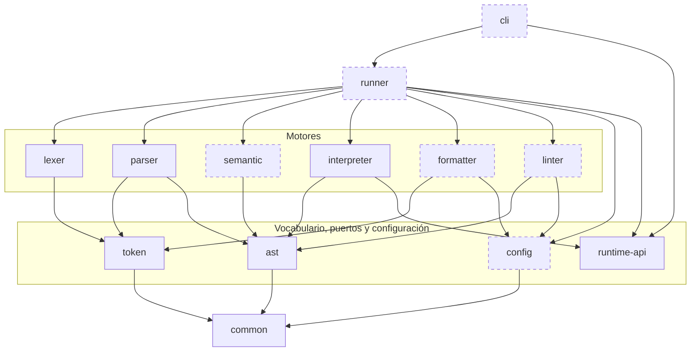
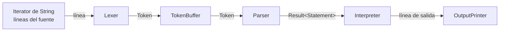

# Arquitectura de PrintScript

Diagrama de componentes, responsabilidad de cada módulo y cómo interactúan entre ellos.

El criterio de descomposición es el de Parnas: cada módulo esconde **una decisión de diseño**, y dos módulos quedan separados si y solo si cambian en momentos distintos y por razones distintas. Las flechas se leen "depende de" y van siempre hacia abajo: el grafo es acíclico.

---

## 1. Estado actual

Siete módulos Gradle, cada uno con su propio set de dependencias, compilando por separado.



Tres cosas para leer en ese grafo:

- **Los tres motores no se conocen entre sí.** No hay ninguna flecha horizontal. Consumen vocabulario, nunca el módulo de al lado.
- **`runtime-api` no depende de nada.** Es un módulo de puertos: no tiene nada debajo y todos lo tienen arriba.
- **Nadie depende de `interpreter`.** Es una hoja: lo que más cambia está arriba de todo, donde romperlo no rompe a nadie.

## 2. Estado completo previsto

Trece módulos. Los de borde punteado todavía no existen.



> Las aristas hacia `common` desde los seis motores, `runner` y `cli` se omiten por legibilidad: **todos dependen de `common`**. `runtime-api` es la única excepción — no necesita nada de él.

Lo que cambia respecto de hoy:

- Aparece **`semantic`** entre el parser y el interpreter. Es la etapa que valida tipos, scope y constancia, y la que hace que el modo Validation de la consigna valide de verdad la semántica y no solo la sintaxis.
- Aparece **`runner`**, el único módulo del sistema donde el lexer y el parser se conocen. Es lo que permite publicar PrintScript como librería sin arrastrar la línea de comandos.
- Aparecen **`formatter`** y **`linter`**, que cuelgan del vocabulario sin conocer al parser: se puede formatear o lintear un programa con errores de tipos.
- Aparece **`config`**, que esconde en qué formato vive la configuración. Recibe streams, nunca paths: abrir archivos es responsabilidad exclusiva de `cli`.
- Aparece **`cli`**, que depende solo de `runner`, `runtime-api` y `common`.

---

## 3. Responsabilidad de cada módulo

| Módulo | Decisión que esconde | Cambia cuando… | Depende de | Estado |
|---|---|---|---|---|
| `common` | Cómo viaja un dato o un error por el pipeline y cómo se ubica algo en el fuente | Casi nunca: cambiaría la forma del pipeline | — | ✅ |
| `token` | Qué es un token y qué categorías existen | Casi nunca: cambia la noción de token, no el lenguaje | `common` | ✅ |
| `ast` | La forma del árbol y el contrato de recorrido | El lenguaje gana construcciones | `common` | ✅ |
| `runtime-api` | Cómo habla un programa en ejecución con el mundo exterior | Cambian los canales de E/S del programa | — | ✅ |
| `lexer` | Cómo se reconoce un token dentro del texto | Cambian las reglas léxicas | `common`, `token` | ✅ |
| `parser` | La gramática y cómo se construye el árbol | Cambian las reglas sintácticas | `common`, `token`, `ast` | ✅ |
| `interpreter` | Qué efecto produce cada nodo al ejecutarse | Cambia la semántica de ejecución | `common`, `ast`, `runtime-api` | ✅ |
| `config` | En qué formato vive la configuración (JSON, YAML, mañana TOML) | Aparecen formatos nuevos | `common` | ⬜ |
| `semantic` | Qué programas bien formados tienen sentido | Cambian las reglas de tipos y scope | `common`, `ast` | ⬜ |
| `formatter` | Cómo se ve el código | Cambian las reglas de estilo | `common`, `token`, `config` | ⬜ |
| `linter` | Qué convenciones se exigen | Cambian las convenciones | `common`, `ast`, `config` | ⬜ |
| `runner` | Cómo se arma el pipeline de cada operación y versión | Aparecen operaciones nuevas | todos los anteriores | ⬜ |
| `cli` | La experiencia de línea de comandos | Cambian argumentos, progreso, exit codes | `runner`, `runtime-api`, `common` | ⬜ |

---

## 4. Cómo interactúan: el pipeline en streaming

La consigna exige que un fuente que no entra en memoria se pueda procesar igual, y que no se haga todo el análisis léxico antes de pasar a la etapa siguiente. De ahí sale el mecanismo central: **ninguna etapa produce una colección, todas producen un flujo**.

El contrato compartido es `PrintScriptIterator<T>`, con `hasNext()` y `getNext()`. Lo implementan las cuatro etapas; lo único que cambia entre ellas es la `T`.



### Dos flujos en direcciones opuestas

Esta es la parte que conviene tener clara: **los datos van hacia adelante, los pedidos van hacia atrás**.

```
DATOS      archivo ──► lexer ──► parser ──► interpreter ──► salida
CONTROL    archivo ◄── lexer ◄── parser ◄── interpreter ◄── while (hasNext)
```

Todo el pipeline es *pull*. Nadie empuja. Cuando el consumidor pide un resultado, ese pedido se propaga hacia atrás hasta el lexer, y si hace falta se lee una línea nueva del archivo. El dato vuelve hacia adelante transformándose en cada etapa.

El texto entra al sistema **en un solo lugar**: el constructor del `Lexer`, que recibe un `Iterator<String>`. Ninguna otra clase tiene una referencia a la fuente.

### Qué está vivo en memoria

En cualquier instante de la ejecución:

- una línea de texto (`Lexer.currentLine`),
- los tokens de la sentencia que se está armando (`TokenBuffer.retained`),
- el árbol de esa sentencia,
- el `Environment` acumulado.

Nunca el programa entero. El único acumulador es el `TokenBuffer`, y su cota es la sentencia más larga.

### Los errores viajan como dato

Ninguna etapa comunica errores de dominio por excepción. El canal es `Result<T>`, que es o `Success<T>(valor)` o `Failure<T>(mensaje, Range)`, y viaja por el mismo camino que los resultados válidos. Todo error lleva el `Range` completo — fila y columna de inicio y de fin — como exige la consigna.

Un error no detiene la iteración: la sentencia siguiente se procesa igual. Decidir si frenar al primer error o acumularlos es una política, y le corresponde al `runner`.

---

## 5. Las aristas que no están, y por qué

Tan importante como las dependencias que existen son las que se evitaron deliberadamente.

**`parser` no depende de `lexer`.** Es la ausencia más importante del diseño. El `TokenBuffer` recibe un `PrintScriptIterator<Token>` cualquiera, así que el parser se escribe, compila y testea sin que exista el lexer — de hecho todos sus tests lo alimentan con listas de tokens armadas a mano. El parser depende de una abstracción estable (el vocabulario `token` más el contrato de iteración), no de una implementación volátil.

**`interpreter` no depende de `parser` ni de `lexer`.** Consume `PrintScriptIterator<Result<Statement>>`. De dónde salgan esas sentencias no es asunto suyo.

**`interpreter` no depende de `token`.** Una vez armado el árbol, los tokens dejaron de existir. Si los conociera, un cambio léxico lo recompilaría sin razón.

**`lexer` no depende de `ast`.** El lexer no sabe qué es una expresión: solo parte texto en piezas.

**`formatter` y `linter` no dependen de `semantic`.** Es lo que permite formatear y lintear código con errores de tipos.

**`cli` no depende de `interpreter`.** Los puertos que el `cli` implementa viven en `runtime-api`, no dentro del intérprete. Si vivieran ahí, el `cli` tendría que depender del intérprete entero para escribir dos clases de tres líneas, y cualquier cambio interno del `Executor` lo recompilaría.

**Nadie depende de `interpreter`, `formatter` ni `linter`.** Son hojas del grafo, y son justamente los módulos que más cambian.

---

## 6. Cómo entra una versión nueva del lenguaje

Cada módulo con conocimiento del lenguaje expone el par `VersionProvider` → `Provider`. **Los motores no saben qué versiones existen**: todo el conocimiento de versión vive en los providers.

```java
// El motor no tiene ni una palabra de PrintScript escrita adentro
public Lexer(Iterator<String> lines, List<TokenConstructor> constructors)

// El provider es el único que sabe qué es la versión 1.0
private static final Set<String> KEYWORDS = Set.of("let", "println", "number", "string");
```

Cuando llegue 1.1 se agrega `LexerProvider11`, `ParserProvider11`, `SemanticProvider11`, `InterpreterProvider11`, `FormatterProvider11` y `LinterProvider11`. Los motores no cambian una línea.

**Riesgo conocido:** los providers reparten el conocimiento de una versión entre varios módulos, lo que permite inconsistencias — un lexer que reconoce `if` con un parser que no sabe qué hacer con él. Se mitiga con tests de integración por versión que ejerciten cada operación completa contra los ejemplos de la consigna.

---

## 7. Trade-offs asumidos

**Streaming contra atomicidad de la ejecución.** En una sola pasada, cuando aparece un error en la sentencia 40, las 39 anteriores ya se ejecutaron y su salida ya salió. Garantizar "no ejecutar nada si hay algún error" exigiría materializar el programa entero, que es lo que la consigna prohíbe. La mitigación es la operación `validate` como pre-chequeo completo: quien necesite atomicidad corre validate y después execute.

**Visitor exhaustivo.** Agregar un nodo al AST rompe en compilación todos los visitors existentes. Se asume como mecanismo de seguridad, no como defecto: el error de compilación funciona como checklist de qué herramienta tiene que decidir qué hacer con la construcción nueva.

**El costo del contrato único.** `ASTVisitor` cubre expresiones y sentencias juntas, así que `Executor` implementa los cuatro `visit` de expresión devolviendo un error, y `ExpressionEvaluator` hace lo simétrico con los tres de sentencia. Son ramas inalcanzables, impuestas por tener un solo contrato publicado de recorrido.

**Trece módulos.** El número no es el criterio; la independencia de razones de cambio sí. `config`, `semantic` y `runtime-api` existen porque cada uno esconde una decisión distinta con evolución propia. La única fusión que no rompería razones de cambio sería `runner` dentro de `cli`, y se descarta porque PrintScript se publica como librería.

---

## 8. El módulo `runner`

Es el único lugar del sistema donde el lexer y el parser se conocen entre sí. `ExecutionRunner` recibe el iterador de líneas, la versión y un `OutputPrinter`, le pide a los tres `VersionProvider` las piezas de esa versión, encadena `Lexer` → `TokenBuffer` → `Parser` → `Interpreter` y corre el bucle `while (hasNext) getNext`. El armado de la cadena lexer→buffer→parser vive en una función privada compartida, pensada para que la fachada de validación la reutilice sin duplicarla.

El invariante del módulo: **compone, no decide**. No tiene ni una regla del lenguaje; todo el conocimiento de versión sigue en los providers.

**La política con los errores es acumular, no cortar.** Las etapas deliberadamente no la toman, así que la decisión vive acá: la fachada junta los `Failure` que salen del bucle — con su mensaje y su `Range` — y los devuelve como lista al terminar. Un error no detiene la ejecución del resto del programa.

**Trade-off asumido.** Como la ejecución es en una sola pasada, cuando aparece un error las sentencias válidas anteriores ya se ejecutaron y su salida ya salió. Quien necesite atomicidad corre primero la validación.
