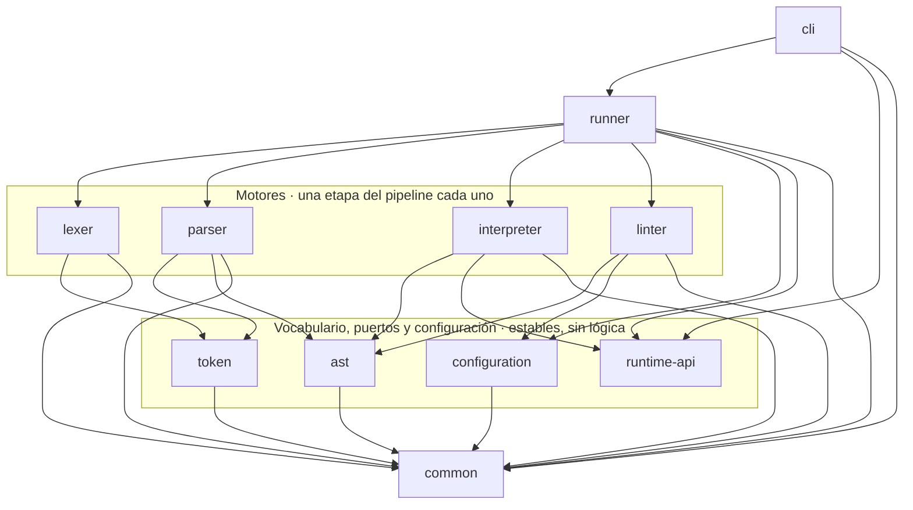
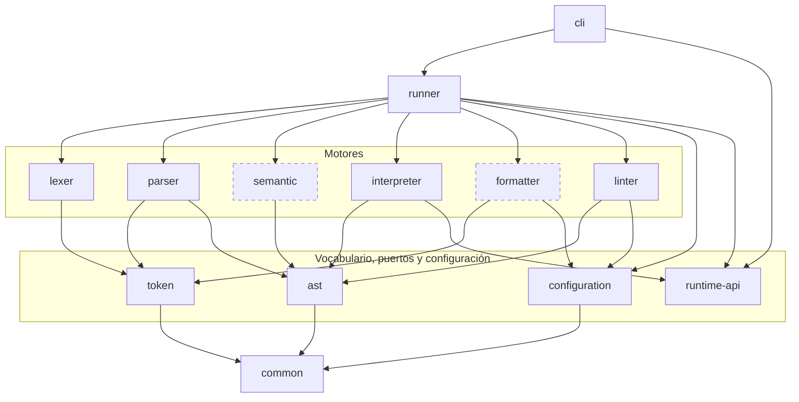
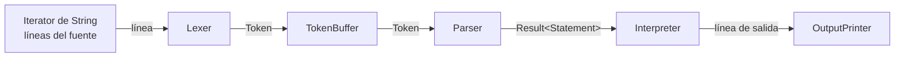

# Arquitectura de PrintScript

Diagrama de componentes, responsabilidad de cada módulo y cómo interactúan entre ellos.

El criterio de descomposición es el de Parnas: cada módulo esconde **una decisión de diseño**, y dos módulos quedan separados si y solo si cambian en momentos distintos y por razones distintas. Las flechas se leen "depende de" y van siempre hacia abajo: el grafo es acíclico.

---

## 1. Estado actual

Once módulos Gradle, cada uno con su propio set de dependencias, compilando por separado.



Cuatro cosas para leer en ese grafo:

- **Los cuatro motores no se conocen entre sí.** No hay ninguna flecha horizontal. Consumen vocabulario, nunca el módulo de al lado. El `linter` en particular no conoce al `parser`: recibe el flujo de sentencias ya armado.
- **`runtime-api` no depende de nada.** Es un módulo de puertos: no tiene nada debajo y todos lo tienen arriba.
- **Nadie depende de `interpreter` ni de `linter`.** Son hojas: lo que más cambia está arriba de todo, donde romperlo no rompe a nadie.
- **`cli` es el único que toca filesystem, `System.out`/`System.err` y códigos de salida**, y el único punto de entrada ejecutable del sistema (`org.printscript.cli.Cli.main`). No depende de `lexer`, `parser`, `interpreter`, `ast` ni `token`: solo de `runner`, `runtime-api` y `common`. Ver sección 9.

## 2. Estado completo previsto

Trece módulos. Los de borde punteado todavía no existen.



> Las aristas hacia `common` desde los seis motores, `runner` y `cli` se omiten por legibilidad: **todos dependen de `common`**. `runtime-api` es la única excepción — no necesita nada de él.

Lo que cambia respecto de hoy:

- Aparece **`semantic`** entre el parser y el interpreter. Es la etapa que valida tipos, scope y constancia, y la que hace que el modo Validation de la consigna valide de verdad la semántica y no solo la sintaxis.
- Aparece **`runner`**, el único módulo del sistema donde el lexer y el parser se conocen. Es lo que permite publicar PrintScript como librería sin arrastrar la línea de comandos.
- Aparece **`formatter`**, que cuelga del vocabulario sin conocer al parser: se puede formatear un programa con errores de tipos.
- Aparece **`cli`**, que depende solo de `runner`, `runtime-api` y `common`.

---

## 3. Responsabilidad de cada módulo

| Módulo | Decisión que esconde | Cambia cuando… | Depende de | Estado |
|---|---|---|---|---|
| `common` | Cómo viaja un dato o un error por el pipeline y cómo se ubica algo en el fuente | Casi nunca: cambiaría la forma del pipeline | — | ✅ |
| `token` | Qué es un token y qué categorías existen | Casi nunca: cambia la noción de token, no el lenguaje | `common` | ✅ |
| `ast` | La forma del árbol y el contrato de recorrido | El lenguaje gana construcciones | `common` | ✅ |
| `runtime-api` | Cómo habla un programa en ejecución con el mundo exterior | Cambian los canales de E/S del programa | — | ✅ |
| `lexer` | Cómo se reconoce un token dentro del texto | Cambian las reglas léxicas | `common`, `token` | ✅ |
| `parser` | La gramática y cómo se construye el árbol | Cambian las reglas sintácticas | `common`, `token`, `ast` | ✅ |
| `interpreter` | Qué efecto produce cada nodo al ejecutarse | Cambia la semántica de ejecución | `common`, `ast`, `runtime-api` | ✅ |
| `configuration` | En qué formato vive la configuración (JSON, YAML, mañana TOML) | Aparecen formatos nuevos | `common` | ✅ |
| `semantic` | Qué programas bien formados tienen sentido | Cambian las reglas de tipos y scope | `common`, `ast` | ⬜ |
| `formatter` | Cómo se ve el código | Cambian las reglas de estilo | `common`, `token`, `configuration` | ⬜ |
| `linter` | Qué convenciones se exigen | Cambian las convenciones | `common`, `ast`, `configuration` | ✅ |
| `runner` | Cómo se arma el pipeline de cada operación | Aparecen operaciones nuevas | todos los anteriores | ✅ |
| `cli` | La experiencia de línea de comandos | Cambian argumentos, progreso, exit codes | `runner`, `runtime-api`, `common` | ✅ |

---

## 4. Cómo interactúan: el pipeline en streaming

La consigna exige que un fuente que no entra en memoria se pueda procesar igual, y que no se haga todo el análisis léxico antes de pasar a la etapa siguiente. De ahí sale el mecanismo central: **ninguna etapa produce una colección, todas producen un flujo**.

El contrato compartido es `PrintScriptIterator<T>`, con `hasNext()` y `getNext()`. Lo implementan las cuatro etapas; lo único que cambia entre ellas es la `T`.



### Dos flujos en direcciones opuestas

Esta es la parte que conviene tener clara: **los datos van hacia adelante, los pedidos van hacia atrás**.

```
DATOS      archivo ──► lexer ──► parser ──► interpreter ──► salida
CONTROL    archivo ◄── lexer ◄── parser ◄── interpreter ◄── while (hasNext)
```

Todo el pipeline es *pull*. Nadie empuja. Cuando el consumidor pide un resultado, ese pedido se propaga hacia atrás hasta el lexer, y si hace falta se lee una línea nueva del archivo. El dato vuelve hacia adelante transformándose en cada etapa.

El texto entra al sistema **en un solo lugar**: el constructor del `Lexer`, que recibe un `Iterator<String>`. Ninguna otra clase tiene una referencia a la fuente.

### Qué está vivo en memoria

En cualquier instante de la ejecución:

- una línea de texto (`Lexer.currentLine`),
- los tokens de la sentencia que se está armando (`TokenBuffer.retained`),
- el árbol de esa sentencia,
- el `Environment` acumulado.

Nunca el programa entero. El único acumulador es el `TokenBuffer`, y su cota es la sentencia más larga.

### Los errores viajan como dato

Ninguna etapa comunica errores de dominio por excepción. El canal es `Result<T>`, que es o `Success<T>(valor)` o `Failure<T>(mensaje, Range)`, y viaja por el mismo camino que los resultados válidos. Todo error lleva el `Range` completo — fila y columna de inicio y de fin — como exige la consigna.

Un error no detiene la iteración: la sentencia siguiente se procesa igual. Decidir si frenar al primer error o acumularlos es una política, y le corresponde al `runner`.

---

## 5. Las aristas que no están, y por qué

Tan importante como las dependencias que existen son las que se evitaron deliberadamente.

**`parser` no depende de `lexer`.** Es la ausencia más importante del diseño. El `TokenBuffer` recibe un `PrintScriptIterator<Token>` cualquiera, así que el parser se escribe, compila y testea sin que exista el lexer — de hecho todos sus tests lo alimentan con listas de tokens armadas a mano. El parser depende de una abstracción estable (el vocabulario `token` más el contrato de iteración), no de una implementación volátil.

**`interpreter` no depende de `parser` ni de `lexer`.** Consume `PrintScriptIterator<Result<Statement>>`. De dónde salgan esas sentencias no es asunto suyo.

**`interpreter` no depende de `token`.** Una vez armado el árbol, los tokens dejaron de existir. Si los conociera, un cambio léxico lo recompilaría sin razón.

**`lexer` no depende de `ast`.** El lexer no sabe qué es una expresión: solo parte texto en piezas.

**`formatter` y `linter` no dependen de `semantic`.** Es lo que permite formatear y lintear código con errores de tipos.

**`cli` no depende de `interpreter`.** Los puertos que el `cli` implementa viven en `runtime-api`, no dentro del intérprete. Si vivieran ahí, el `cli` tendría que depender del intérprete entero para escribir dos clases de tres líneas, y cualquier cambio interno del `Executor` lo recompilaría.

**Nadie depende de `interpreter`, `formatter` ni `linter`.** Son hojas del grafo, y son justamente los módulos que más cambian.

---

## 6. Cómo entra una versión nueva del lenguaje

Cada módulo con conocimiento del lenguaje expone una **factory**: `LexerFactory`, `ParserFactory` e `InterpreterFactory`. **Los motores no saben nada de PrintScript**: reciben ya armadas las piezas que definen el lenguaje.

```java
// El motor no tiene ni una palabra de PrintScript escrita adentro
public Lexer(Iterator<String> lines, List<TokenConstructor> constructors)

// La factory es la única que sabe qué palabras tiene el lenguaje
keywords.put("let", TokenType.KEYWORD);
keywords.put("println", TokenType.KEYWORD);
```

Esa separación es la que importa y es la que sigue en pie: **el conocimiento del lenguaje está concentrado en tres archivos**, y los motores no cambian cuando el lenguaje cambia. Agregar `const` es una línea en `LexerFactory`.

**El despacho por versión se quitó, y conviene dejar escrito por qué.** Hasta el 25/08/2026 existía un nivel más: el par `VersionProvider` → `Provider`, con `providerFor("1.0")` devolviendo el provider de esa versión, y la versión viajando como `String` por las firmas públicas de las dos fachadas del `runner`. Se eliminó en el PR #9 porque hoy existe **una sola versión** del lenguaje: eran tres interfaces, tres implementaciones de despacho y un parámetro en cada firma pública para elegir siempre la misma opción. Era andamiaje para un problema que todavía no se tiene.

**Qué cuesta reintroducirlo cuando aparezca 1.1.** El cambio queda contenido en dos lugares: cada factory gana un método de despacho por versión — o vuelve la interfaz `VersionProvider` a `common` —, y el parámetro `version` vuelve a las firmas de `ExecutionRunner.run` y `ValidationRunner.validate`. **Los motores, el vocabulario y el AST no se tocan**, que es exactamente la propiedad que esta separación vino a comprar. El costo asumido es un refactor de firmas públicas el día que llegue la 1.1; el beneficio es no cargar hoy con un mecanismo especulativo.

**Riesgo conocido:** las tres factories reparten el conocimiento del lenguaje entre varios módulos, lo que permite inconsistencias — un lexer que reconoce `if` con un parser que no sabe qué hacer con él. Se mitiga por dos vías: la compuerta de nodos del `Interpreter`, que ante un nodo que no sabe ejecutar devuelve un `Failure` explícito en vez de romper, y los tests end-to-end del `runner`, que ejercitan el pipeline completo contra los ejemplos de la consigna.

---

## 7. Trade-offs asumidos

**Streaming contra atomicidad de la ejecución.** En una sola pasada, cuando aparece un error en la sentencia 40, las 39 anteriores ya se ejecutaron y su salida ya salió. Garantizar "no ejecutar nada si hay algún error" exigiría materializar el programa entero, que es lo que la consigna prohíbe. La mitigación es la operación `validate` como pre-chequeo completo: quien necesite atomicidad corre validate y después execute.

**Visitor exhaustivo.** Agregar un nodo al AST rompe en compilación todos los visitors existentes. Se asume como mecanismo de seguridad, no como defecto: el error de compilación funciona como checklist de qué herramienta tiene que decidir qué hacer con la construcción nueva.

**El costo del contrato único.** `ASTVisitor` cubre expresiones y sentencias juntas, así que `Executor` implementa los cuatro `visit` de expresión devolviendo un error, y `ExpressionEvaluator` hace lo simétrico con los tres de sentencia. Son ramas inalcanzables, impuestas por tener un solo contrato publicado de recorrido.

**Trece módulos.** El número no es el criterio; la independencia de razones de cambio sí. `configuration`, `semantic` y `runtime-api` existen porque cada uno esconde una decisión distinta con evolución propia. La única fusión que no rompería razones de cambio sería `runner` dentro de `cli`, y se descarta porque PrintScript se publica como librería.

---

## 8. El módulo `runner`

Es el único lugar del sistema donde el lexer y el parser se conocen entre sí. `ExecutionRunner` recibe el iterador de líneas y un `OutputPrinter`, le pide a las tres factories las piezas del pipeline, encadena `Lexer` → `TokenBuffer` → `Parser` → `Interpreter` y corre el bucle `while (hasNext) getNext`. El armado de la cadena lexer→buffer→parser vive en `StatementStreams`, una clase package-private con una única función estática que comparten las dos fachadas: la construcción existe en un solo lugar.

`ValidationRunner` es la segunda fachada: arma la misma cadena pero se detiene en el parser, sin interpreter y sin `OutputPrinter` — la firma de `validate` ni siquiera recibe uno. Recorre el flujo de sentencias, junta los `Failure` con su mensaje y su `Range`, y no ejecuta nada: validar un programa con `println` no imprime. Queda anotado explícitamente: la consigna pide validar sintaxis **y semántica**, y el módulo `semantic` no existe todavía, así que esta fachada valida solo sintaxis. Cuando `semantic` exista, se encadena entre el parser y el consumidor sin que ninguna de las dos etapas cambie.

`AnalyzingRunner` es la tercera fachada: arma `Lexer` → `TokenBuffer` → `Parser` → `Linter` reusando el mismo `StatementStreams`, y devuelve un `AnalysisReport` con dos listas separadas — las violaciones de estilo y los errores de sintaxis. **No pasa por `semantic`**, y no va a pasar cuando exista: se puede lintear un programa que no tipa. Tiene un segundo `analyze` que recibe el stream de configuración y su formato, y es el único lugar donde se cablean los mappers de `configuration`.

El invariante del módulo: **compone, no decide**. No tiene ni una regla del lenguaje; todo el conocimiento del lenguaje sigue en las factories.

**La política con los errores es acumular, no cortar.** Las etapas deliberadamente no la toman, así que la decisión vive acá: la fachada junta los `Failure` que salen del bucle — con su mensaje y su `Range` — y los devuelve como lista al terminar. Un error no detiene la ejecución del resto del programa.

**Trade-off asumido.** Como la ejecución es en una sola pasada, cuando aparece un error las sentencias válidas anteriores ya se ejecutaron y su salida ya salió. Quien necesite atomicidad corre primero la validación.

**Comportamiento anotado: imprimir una variable declarada sin valor.** Hoy el valor guardado para una declaración sin inicializador es `null`, y `asText` lo convierte con `String.valueOf`, así que `println` imprime `null`. No es lo que debería pasar en un lenguaje con chequeo de tipos, pero nadie lo detecta porque `semantic` no existe. Queda pendiente de ese módulo.

---

## 9. El módulo `cli`

Es el único punto de entrada ejecutable del sistema (`org.printscript.cli.Cli.main`) y el único módulo autorizado a tocar filesystem, `System.out`/`System.err` y códigos de salida — el resto son librerías puras. Traduce argumentos con **picocli** a un `RootCommand` con cuatro subcomandos, uno por operación de la consigna: `execution`, `validation`, `formatting` y `analyzing` (con sus alias). A partir de ahí nada depende de picocli salvo las clases de comando mismas.

`ExecutionCommand` y `ValidationCommand` comparten `AbstractSourceFileCommand`: abre el archivo fuente, arma un `Iterator<String>` de líneas y delega en la operación concreta, que llama a `ExecutionRunner`/`ValidationRunner`. Cero lógica de lenguaje en `cli`: solo abre el archivo, arma el iterador y reporta lo que el `runner` devuelve.

**Progreso durante el parseo.** `ProgressReportingIterator` decora el iterador de líneas: estima el porcentaje consumido con `Files.size` (una sola llamada, sin releer el archivo) y bytes acumulados por línea, y solo escribe a `System.err` cuando el porcentaje entero cambia. El lexer y el parser nunca se enteran de que existe.

**Errores con rango completo.** `FailureReporter` formatea cada `Failure` (mensaje + `Range` con fila/columna de inicio y fin) a `System.err`, tal como exige la consigna.

**`--version` no viaja al `runner`.** La consigna pide un argumento de versión del lenguaje ("por ahora solo 1.0"); `cli` lo valida en el borde (`LanguageVersion`, un converter de picocli que rechaza cualquier valor que no sea `"1.0"`) pero no lo pasa a `ExecutionRunner`/`ValidationRunner`, que no tienen ese parámetro (ver sección 6). Cuando exista una 1.1 real, el punto de entrada para el despacho sigue siendo el que describe esa sección — las factories, no `cli`.

**`formatting` y `analyzing` son stubs de superficie, no simulacros.** Los módulos `formatter`, `linter` y `semantic` todavía no existen, así que ambas operaciones están expuestas en el choice cerrado de 4 que pide la consigna (aceptan archivo y `--config`) pero terminan con un mensaje explícito de "no implementado todavía" y el exit code `3`, en vez de fingir un resultado.

**Códigos de salida:** `0` éxito, `1` el programa `.ps` tiene errores de validación o ejecución, `2` error de uso (argumentos inválidos, versión no soportada, archivo inexistente), `3` operación pedida pero no implementada. Guía de uso completa con ejemplos en [`docs/cli.md`](cli.md).

## 10. El módulo `linter`

Es el *static code analyzer* que pide la consigna: analiza los programas PrintScript del usuario. **No tiene nada que ver con Checkstyle, PMD ni Spotless**, que analizan nuestro código Java y viven en `config/` y en `buildSrc/`.

Es una etapa más del pipeline: implementa `PrintScriptIterator<Result<List<Violation>>>` y decora al parser, así que consume una sentencia por vez y un fuente que no entra en memoria se lintea igual que se ejecuta.

**Las violaciones viajan como dato.** Por cada sentencia, o un `Failure` reenviado del parser, o un `Success` con la lista de lo que incumple — vacía cuando está limpia. Ninguna regla corta a las que siguen y ninguna violación corta a la sentencia siguiente, que es lo que pide la consigna cuando dice que hay que reportar todos los incumplimientos.

**Cada violación lleva el `Range` de aquello de lo que habla**, no el de la sentencia entera: el del identificador mal escrito, el del argumento inválido. Para eso `VariableDeclaration` y `AssignmentStatement` guardan su nombre como `Identifier` y no como `String`.

### El recorrido se escribe una sola vez

`IdentifierCollector` es un `ASTVisitor<List<Identifier>>` y es el único lugar donde se baja por el árbol. Las reglas lo usan; no recorren. Cuando el AST gane un nodo, el visitor deja de compilar y avisa dónde hay que decidir.

`PrintlnArgumentRule` no recorre nada: mira el hijo inmediato del `println` con un switch exhaustivo sobre `Expression`. La regla está escrita en positivo — solo un identificador o un literal — así que un tipo de expresión nuevo también rompe la compilación en vez de colarse.

### Las reglas se configuran al construirse

`LintRule` tiene un solo método, `check(Statement)`. La configuración no viaja en cada llamada y la regla no guarda estado: `LinterFactory` decide qué reglas existen y con qué parámetros, y **una regla apagada simplemente no está en la lista**.

| Clave del archivo | Qué prende | Valores |
|---|---|---|
| `identifier_format` | El formato exigido a los identificadores | `camel case` (también `camelCase` y `camel_case`) |
| `mandatory-variable-or-literal-in-println` | Que `println` reciba solo un identificador o un literal | `true` / `false` |

Una clave ausente deja la regla apagada. Un valor **desconocido** en `identifier_format` rompe con un mensaje que nombra el valor recibido y los soportados, en vez de apagar la regla en silencio.

**`snake case` no está soportado a propósito.** La consigna admite camel case o snake case y el equipo eligió uno solo. Sumarlo es una clase que implemente `IdentifierFormatChecker` y un valor más en el enum: nada de lo que ya está escrito cambia.

### El linter no sabe qué es JSON

Recibe una `LinterConfiguration` tipada. Leer el archivo es trabajo de `configuration`, y traducir esa configuración genérica a la del linter es trabajo de `LinterConfiguration.from`. Así el módulo no arrastra Jackson y sus tests no necesitan un archivo.
